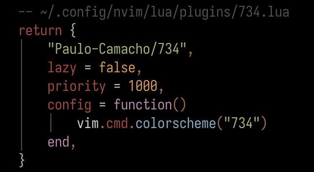

# 734

A dark and light Neovim colorscheme with an orange cursor and orange yank flash.
The dark variant sits on pure black.

| variant | command | background | floats | cursor |
| --- | --- | --- | --- | --- |
| dark | `:colorscheme 734` | `#000000` | `#000000` | `#ff6900` |
| light | `:colorscheme 734-light` | `#fcfcfc` | `#f2f2f2` | `#ff6900` |

In the dark variant, floating windows share the editor's black background and
are set apart by their border. The cursorline, completion menu and folds use
`#202020`.

<!-- screenshots: add images of both variants here -->

## Requirements

- Neovim 0.10+
- `termguicolors` on (the palette is 24-bit; cterm coverage is minimal)

## Install

### lazy.nvim

 

### vim.pack (Neovim 0.12+)
```lua
-- ~/.config/nvim/init.lua
vim.pack.add({ "https://github.com/Paulo-Camacho/734" })
vim.cmd.colorscheme("734")
vim.cmd.colorscheme("734-light")
```

### Manual

Copy `colors/` and `lua/` into `~/.config/nvim/`.

## Orange cursor and yank

The cursor and yank flash are `#ff6900` in both variants. Loading either one
also:

- attaches the `Cursor` group to `'guicursor'` so Neovim, not the terminal,
  colors the cursor. Skipped if your `'guicursor'` already names `Cursor` or
  `lCursor`, or is empty. Re-applied if you change `'guicursor'` later.
  Needs `termguicolors` on, and your terminal must support OSC 12 (kitty,
  WezTerm, Ghostty, foot, Alacritty, iTerm2 do).
- flashes yanked text with the `Yank734` group.

Opt out before loading the colorscheme:

```lua
vim.g.theme734_cursor = false -- leave 'guicursor' alone
vim.g.theme734_yank = false   -- no yank flash (use this if you already have a TextYankPost highlight)
```

## License

MIT
