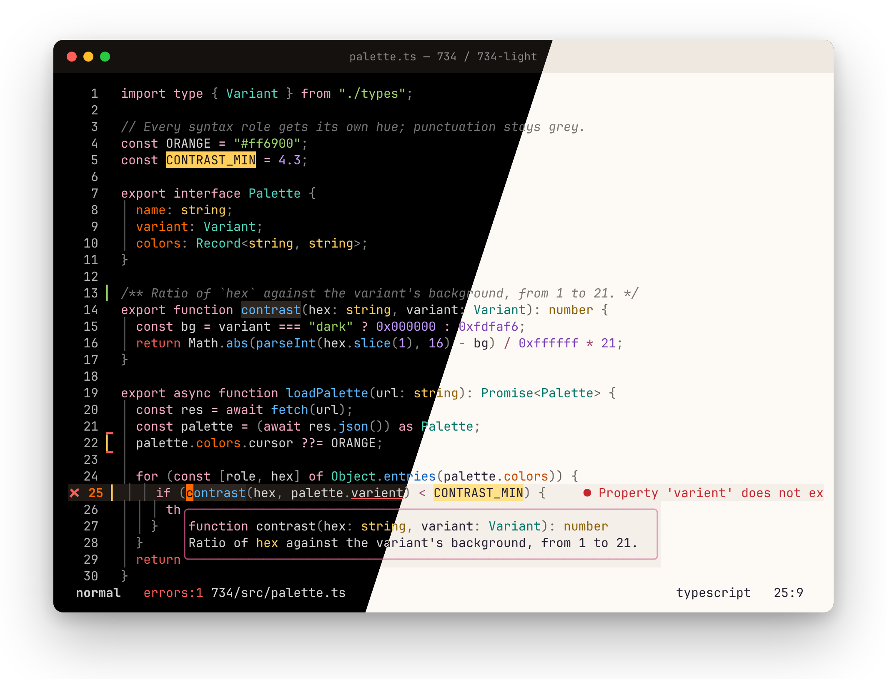
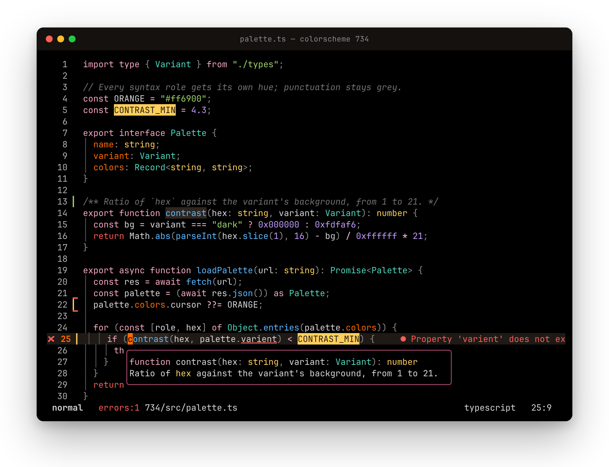
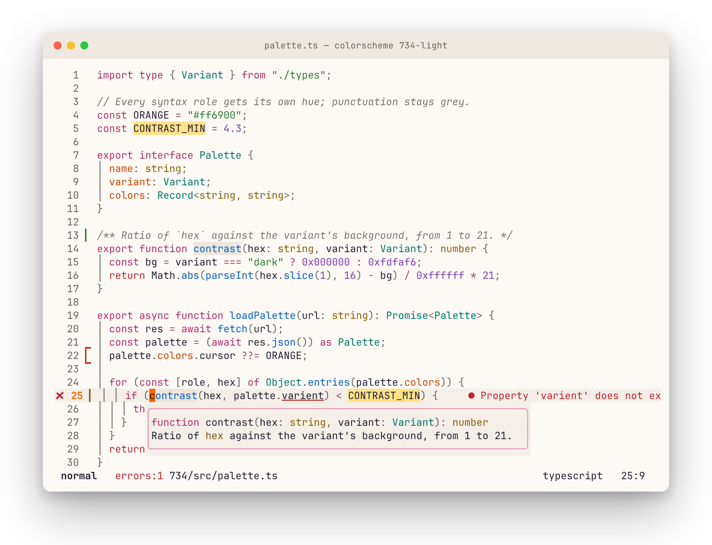

# 734

A dark and light Neovim colorscheme with an orange cursor and orange yank flash.
The dark variant sits on pure black.



| variant | command | background | floats | cursor |
| --- | --- | --- | --- | --- |
| dark | `:colorscheme 734` | `#000000` | `#000000` | `#ff6900` |
| light | `:colorscheme 734-light` | `#fdfaf6` | `#f4efe9` | `#ff6900` |

In the dark variant, floating windows share the editor's black background and
are set apart by a pink border (`#a3466b`). The cursorline, completion menu
and folds use a warm `#1f1a16`.

## Palette

Pink is the theme's highlight color: keywords, titles, the selected tab,
matching brackets, the current search hit and the normal-mode statusline all
use it. The cursor's orange stays on the cursor, yank flash and cursor line
number, and carries over to properties and fields. Every other syntax role gets
its own hue so code reads at a glance, and punctuation is pushed back to grey.

| role | dark | light |
| --- | --- | --- |
| keyword, `if`, `for`, `import` | `#f4a6c0` | `#b0306a` |
| `return`, exceptions | `#ff5c57` | `#c4262e` |
| function | `#5cb8ff` | `#0a5fc4` |
| string | `#9bd36a` | `#2e7d32` |
| type, module | `#4fd6be` | `#00766a` |
| number, constant, boolean | `#c39bff` | `#7b3fb5` |
| property, field | `#ff6900` | `#c94a00` |
| builtin, macro, escape | `#ffcf5c` | `#8a5d00` |
| operator | `#ffc2da` | `#9e4a6e` |
| punctuation | `#8c8c8c` | `#6b655e` |
| comment (italic) | `#737373` | `#7d766e` |
| selection | `#3d1a2b` | `#ffd6e7` |

Every syntax color meets roughly WCAG AA (4.3:1 or better) against its background.

## Screenshots

Real Neovim captures: TypeScript with Tree-sitter, a ts_ls hover and
diagnostic, a search hit, gitsigns and a custom statusline. Regenerate them
with `scripts/screenshots/make.sh`.

### Dark — `:colorscheme 734`



### Light — `:colorscheme 734-light`



## Requirements

- Neovim 0.11+ (the yank flash uses `vim.hl.on_yank`)
- `termguicolors` on (the palette is 24-bit; cterm coverage is minimal)

## Install

### lazy.nvim

```lua
-- ~/.config/nvim/lua/plugins/734.lua
return {
  "Paulo-Camacho/734",
  lazy = false,
  priority = 1000,
  config = function()
    vim.cmd.colorscheme("734") -- or "734-light"
  end,
}
```

### vim.pack (Neovim 0.12+)
```lua
-- ~/.config/nvim/init.lua
vim.pack.add({ "https://github.com/Paulo-Camacho/734" })
vim.cmd.colorscheme("734") -- or "734-light"
```

### Manual

Copy `colors/` and `lua/` into `~/.config/nvim/`.

## Orange cursor and yank

The cursor and yank flash are `#ff6900` in both variants. Loading either one
also:

- attaches the `Cursor` group to `'guicursor'` so Neovim, not the terminal,
  colors the cursor. Skipped if your `'guicursor'` already names `Cursor` or
  `lCursor`, or is empty. Re-applied if you change `'guicursor'` later.
  Needs `termguicolors` on, and your terminal must support OSC 12 (kitty,
  WezTerm, Ghostty, foot, Alacritty, iTerm2 do).
- flashes yanked text with the `Yank734` group.

Opt out before loading the colorscheme:

```lua
vim.g.theme734_cursor = false -- leave 'guicursor' alone
vim.g.theme734_yank = false   -- no yank flash (use this if you already have a TextYankPost highlight)
```

## License

MIT
